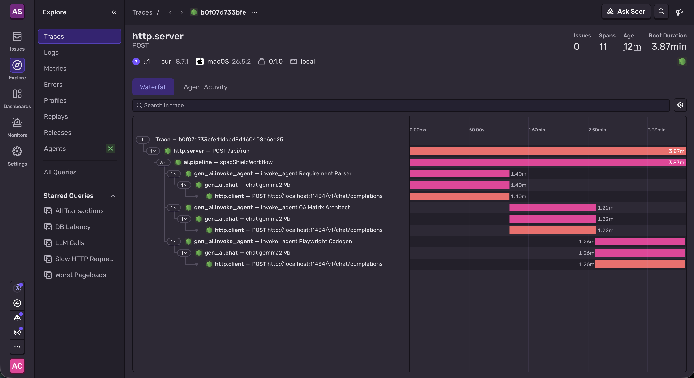

# Master Implementation Prompt — SpecShield QA

This file has two parts. **Part 1** is the one-shot build prompt that was run in OpenCode
(Muse Spark 1.3). **Part 2** is the follow-up that swapped the sample spec and fixed live Gemma
latency; it was run in Antigravity 3.8 after the OpenCode quota ran out.

## Part 1 — One-shot build (OpenCode, Muse Spark 1.3)

> Copy everything below the horizontal rule into OpenCode (model: **Muse Spark 1.3**) as a
> single first message, from inside the empty `specshield-qa` directory. Do not split it into
> multiple messages; the whole session transcript becomes the DevRelay artifact.

---

You are a senior full-stack TypeScript engineer and technical writer. You are building
**SpecShield QA** from scratch in the current directory (`specshield-qa`, an initialised git
repository that currently holds only planning docs, a `.gitignore`, an `opencode.json` and a
`.devrelay-home/` folder; never modify or delete those four) for the Hacktoberfest Open-Source AI Challenge Week 2 (theme: *Side
Hustle*). You will scaffold the project, implement it end to end, verify it compiles and runs,
and write the publication-ready DEV article `DEV_SUBMISSION.md`. Work autonomously until every
item in the **Acceptance Checklist** at the end passes. Do not ask me questions; make the
decision this document implies and keep going. Do not stop early, do not leave `TODO`
comments, stubs, lorem ipsum, or "implement later" notes anywhere in the code.

## 0. What SpecShield QA is

**Tagline:** Local-First Spec-to-Test & Playwright E2E Studio for Dev Agencies & Freelance QA
Engineers.

**Problem:** Boutique software agencies and freelance QA engineers sign NDAs that forbid pasting
client requirement docs into cloud LLMs. They still spend 4–6 unbillable hours per sprint
turning PRDs into test scenarios and Playwright boilerplate.

**Solution:** Paste a spec (or load the bundled sample), and a three-agent **Mastra** workflow
running **Google Gemma locally through Ollama** produces (1) structured requirements, (2) a
filterable QA test matrix, (3) a downloadable Playwright `.spec.ts` suite using the Page Object
Model. The spec never leaves the laptop, inference costs $0.00, and every agent step is traced
with **Sentry Agent Tracing**. Past runs persist to a local JSON file with zero setup.

**Non-negotiable principles:**
1. The app must run and look finished even if Ollama is **not** installed (deterministic fallback).
2. The app must run even if `SENTRY_DSN` is empty (spans become no-ops; the UI telemetry drawer reads an in-process collector).
3. One command: `npm install && npm run dev`. No Docker, no external database, no cloud services.
4. Nothing is misrepresented: every artifact carries `mode: "gemma" | "fallback"`.

## 1. Stack (use exactly this)

| Layer | Choice |
|---|---|
| Client | Vite 6, React 19, TypeScript 5, Tailwind CSS 3.4, `lucide-react`, `zustand` (small store), `clsx` |
| Server | Hono + `@hono/node-server`, run with `tsx`, ESM (`"type": "module"`) |
| Agents | `@mastra/core` (latest stable), `zod` |
| Model | Gemma via Ollama OpenAI-compatible endpoint (`OLLAMA_BASE_URL`, default `http://localhost:11434/v1`, model `GEMMA_MODEL`, default `gemma2:9b`) |
| Tracing | `@sentry/node` |
| Dev tooling | `concurrently`, `eslint` + `typescript-eslint` (light config), `@types/node`, `@types/react`, `@types/react-dom`, `@vitejs/plugin-react`, `autoprefixer`, `postcss` |
| Persistence | Hand-rolled `JsonStore` writing `./data/runs.json` atomically (write temp file, rename). No SQLite dependency. |

Install with `npm install` and pin exact versions in `package.json` (run `npm install
<pkg>@latest --save-exact`). Node 24 is available; `--env-file` is supported natively, so do not
add `dotenv`.

**Critical instruction about Mastra:** its API changed between 0.x and 1.x. After installing,
open `node_modules/@mastra/core/package.json` to read the version, then read the type
definitions for `@mastra/core/agent`, `@mastra/core/workflows` and `@mastra/core/mastra` before
writing any agent or workflow code. Use the APIs that actually exist in the installed version
(for example `createRun()` vs `createRunAsync()`, `usage.inputTokens` vs
`usage.promptTokens`, `structuredOutput` vs `output`). Never invent a method name. If the
object-form model config `{ id: "custom/gemma2:9b", url, apiKey }` is not accepted by the
installed types, install `@ai-sdk/openai-compatible` and pass
`createOpenAICompatible({ name: "ollama", baseURL })(GEMMA_MODEL)` as the model instead.

## 2. Repository layout (create exactly this)

```
specshield-qa/
├── README.md
├── LICENSE                         MIT, 2026, "SpecShield QA contributors"
├── DEV_SUBMISSION.md               see §8
├── .env.example                    see §3
├── .gitignore                      ALREADY EXISTS — keep its entries (.devrelay-home/, opencode.json) and add node_modules, dist, .env, data/, *.log, .DS_Store if missing
├── package.json  tsconfig.json  tsconfig.app.json  tsconfig.server.json
├── vite.config.ts  tailwind.config.ts  postcss.config.js  index.html  eslint.config.js
├── scripts/smoke.ts                boots server in FORCE_FALLBACK mode, posts sample spec, asserts result
├── docs/.gitkeep                   screenshots will live here
├── shared/
│   ├── types.ts                    contracts in §4 (verbatim)
│   ├── schemas.ts                  zod schemas mirroring types.ts
│   ├── sampleSpec.ts               the PRD in §5 (verbatim), exported as SAMPLE_SPEC + SAMPLE_SPEC_TITLE
│   └── roi.ts                      computeRoi()
├── server/
│   ├── instrument.ts               Sentry.init; MUST be the first import of server/index.ts
│   ├── index.ts                    Hono app; serves dist/ when NODE_ENV=production
│   ├── env.ts                      typed env with defaults from §3
│   ├── routes/{health,run,runs}.ts
│   ├── services/{ollama,telemetry,store,json,events}.ts
│   ├── services/fallback/{parseRequirements,buildMatrix,generatePlaywright,sampleCanned}.ts
│   └── mastra/
│       ├── index.ts  model.ts
│       ├── agents/{requirementParser,qaMatrixArchitect,playwrightCodegen}.ts
│       ├── prompts/{parser,matrix,codegen}.ts
│       └── workflows/specShieldWorkflow.ts
└── src/
    ├── main.tsx  App.tsx  index.css
    ├── lib/{api,sse,download,format}.ts
    ├── hooks/{useHealth,usePipeline,useRuns}.ts
    ├── state/pipelineStore.ts
    └── components/
        ├── layout/{Header,PrivacyBadge,RoiCalculator}.tsx
        ├── editor/{SpecEditor,LoadSampleButton}.tsx
        ├── pipeline/{PipelineProgress,AgentStepCard}.tsx
        ├── workspace/{WorkspaceTabs,QaMatrixTab,TestCaseRow,PlaywrightTab,CodeBlock,TelemetryDrawer,HistoryTab,RunDiff}.tsx
        └── ui/{Badge,Button,Tabs,EmptyState,Kbd}.tsx
```

Use a `@shared/*` path alias in all three tsconfigs and in `vite.config.ts` (`resolve.alias`).
Server tsconfig: `module: NodeNext`, `moduleResolution: NodeNext`, `target: ES2022`, `strict:
true`, `noUncheckedIndexedAccess: true`. Client tsconfig: `jsx: react-jsx`, `moduleResolution:
bundler`, `strict: true`.

`package.json` scripts:

```json
{
  "dev": "concurrently -k -n api,web -c cyan,magenta \"npm:dev:api\" \"npm:dev:web\"",
  "dev:api": "tsx watch --env-file-if-exists=.env server/index.ts",
  "dev:web": "vite",
  "build": "npm run typecheck && vite build",
  "typecheck": "tsc -p tsconfig.app.json --noEmit && tsc -p tsconfig.server.json --noEmit",
  "start": "NODE_ENV=production tsx --env-file-if-exists=.env server/index.ts",
  "smoke": "FORCE_FALLBACK=true tsx scripts/smoke.ts",
  "lint": "eslint ."
}
```

(If the installed Node rejects `--env-file-if-exists`, use `--env-file=.env` and make
`scripts/postinstall` copy `.env.example` to `.env` when missing.)

## 3. `.env.example` (verbatim)

```bash
# ── Local Gemma inference (Ollama OpenAI-compatible endpoint) ───────────────
OLLAMA_BASE_URL=http://localhost:11434/v1
GEMMA_MODEL=gemma2:9b            # or gemma3:12b / gemma3:4b
GEMMA_TEMPERATURE=0.2
GEMMA_MAX_TOKENS=4096
OLLAMA_TIMEOUT_MS=120000

# ── Sentry Agent Tracing (leave DSN empty to run fully air-gapped) ──────────
SENTRY_DSN=
SENTRY_ENVIRONMENT=local
SENTRY_TRACES_SAMPLE_RATE=1.0
SENTRY_SEND_DEFAULT_PII=true     # needed for prompt/response previews in the AI Agents view

# ── App ──────────────────────────────────────────────────────────────────────
PORT=8787
DATA_DIR=./data
FORCE_FALLBACK=false             # set true to demo fallback mode even with Ollama running

# ── ROI defaults (editable in the UI) ───────────────────────────────────────
ROI_HOURLY_RATE_USD=85
ROI_MANUAL_MINUTES_PER_TEST_CASE=12
ROI_CLOUD_INPUT_USD_PER_MTOK=3
ROI_CLOUD_OUTPUT_USD_PER_MTOK=15
```

## 4. Shared contracts (`shared/types.ts`, implement verbatim; `schemas.ts` mirrors them in zod)

```ts
export type AgentMode = "gemma" | "fallback";
export type TestCategory = "Functional" | "Boundary" | "Negative" | "Security";
export type Priority = "P0" | "P1" | "P2" | "P3";
export type StepId = "requirementParser" | "qaMatrixArchitect" | "playwrightCodegen";

export interface ParsedRequirements {
  title: string;
  summary: string;
  roles: { name: string; description: string }[];
  features: { id: string; name: string; description: string; roles: string[] }[];
  acceptanceCriteria: { id: string; featureId: string; text: string }[];
  fields: { name: string; type: string; required: boolean; constraints: string[]; featureId: string }[];
  validationRules: { id: string; rule: string; featureId: string }[];
  securitySurfaces: string[];
}

export interface TestCase {
  id: string;                       // "VND-FUNC-001", "VND-BND-004", "VND-NEG-002", "VND-SEC-003"
  featureId: string;
  category: TestCategory;
  title: string;
  given: string;
  when: string;
  then: string;
  priority: Priority;
  expectedResult: string;
  tags: string[];
}

export interface PlaywrightSuite {
  fileName: string;                 // "vendor-onboarding.spec.ts"
  pageObjects: { className: string; fileName: string; code: string }[];
  specCode: string;                 // the .spec.ts importing POMs from ./pages/*
  combinedCode: string;             // single-file version: POM classes inlined above the tests
  coverage: { testCaseId: string; testName: string }[];
}

export interface TelemetryStep {
  step: StepId;
  agentName: string;
  status: "pending" | "running" | "success" | "fallback" | "error";
  mode: AgentMode;
  startedAt: number;
  endedAt?: number;
  durationMs?: number;
  model: string;
  promptChars: number;
  inputTokens: number;
  outputTokens: number;
  sentryTraceId?: string;
  sentrySpanId?: string;
  error?: string;
}

export interface RoiAssumptions {
  hourlyRateUsd: number;
  manualMinutesPerTestCase: number;
  cloudInputUsdPerMTok: number;
  cloudOutputUsdPerMTok: number;
}

export interface RoiEstimate {
  testCaseCount: number;
  pageObjectCount: number;
  estimatedManualHours: number;     // (testCases * minutesPerCase + pageObjects * 25 min + 45 min review) / 60, min 1.0
  hourlyRateUsd: number;
  billableValueUsd: number;
  totalInputTokens: number;
  totalOutputTokens: number;
  cloudEquivalentCostUsd: number;
  localCostUsd: 0;
  pipelineSeconds: number;
}

export interface RunRecord {
  id: string;
  createdAt: string;                // ISO
  title: string;
  specHash: string;                 // sha256 hex, first 12 chars
  specChars: number;
  spec: string;
  mode: AgentMode | "mixed";
  model: string;
  requirements: ParsedRequirements;
  testCases: TestCase[];
  playwright: PlaywrightSuite;
  telemetry: TelemetryStep[];
  roi: RoiEstimate;
  sentryTraceId?: string;
}

export interface HealthResponse {
  ok: true;
  ollamaReachable: boolean;
  modelAvailable: boolean;
  model: string;
  baseUrl: string;
  mode: AgentMode;
  forcedFallback: boolean;
  sentryEnabled: boolean;
  availableModels: string[];
}

export type PipelineEvent =
  | { type: "pipeline:start"; runId: string; mode: AgentMode; model: string }
  | { type: "step:start"; runId: string; step: TelemetryStep }
  | { type: "step:end"; runId: string; step: TelemetryStep; preview?: { label: string; value: string } }
  | { type: "pipeline:end"; runId: string; record: RunRecord }
  | { type: "error"; runId: string; message: string };
```

## 5. Bundled sample spec (`shared/sampleSpec.ts`, export as a template-literal string, verbatim)

`SAMPLE_SPEC_TITLE = "Enterprise Vendor Onboarding & KAM Site Survey Portal"`

```markdown
# Enterprise Vendor Onboarding & KAM Site Survey Portal — Product Requirements (v2.3)

## 1. Background
Meridian Industrial Coatings onboards 300–400 new suppliers per year across 14 countries. Today
onboarding runs over email and spreadsheets, takes a median of 23 business days, and Compliance
rejects 31% of submissions for missing documents. The portal replaces that process with a
self-service vendor workflow, a structured site survey performed by the Key Account Manager
(KAM), and a two-stage approval with a full audit trail.

## 2. User Roles
- **Vendor Admin** — external supplier user who registers the company, uploads documents and tracks status.
- **Key Account Manager (KAM)** — internal; performs on-site surveys, scores the vendor, recommends approval.
- **Procurement Reviewer** — internal; validates commercial terms and bank details; first-stage approver.
- **Compliance Officer** — internal; validates certifications and sanctions screening; final approver.
- **System Administrator** — manages users, roles, country configurations and retention policies.

## 3. Functional Requirements

### 3.1 Vendor Registration (FR-REG)
- FR-REG-01: A Vendor Admin can create an account with corporate email, password and company name. Free-mail domains (gmail.com, yahoo.com, outlook.com, hotmail.com) must be rejected with the message "Please use a corporate email address".
- FR-REG-02: Passwords must be 12–64 characters and include at least one uppercase letter, one digit and one symbol.
- FR-REG-03: Email verification link expires after 24 hours; an expired link shows a "Resend verification" action.
- FR-REG-04: Company legal name is required, 2–120 characters. Duplicate legal names within the same country trigger a warning but do not block registration.
- FR-REG-05: Tax identifier is required and validated per country: India GSTIN (15 characters, pattern `^[0-9]{2}[A-Z]{5}[0-9]{4}[A-Z][1-9A-Z]Z[0-9A-Z]$`), EU VAT (country prefix + 8–12 alphanumerics), US EIN (`^\d{2}-\d{7}$`). Unsupported countries accept free text up to 32 characters.

### 3.2 Document Upload (FR-DOC)
- FR-DOC-01: Required documents: Certificate of Incorporation, Tax Registration, Bank Confirmation Letter, ISO 9001 certificate (optional for vendors with annual contract value under USD 50,000).
- FR-DOC-02: Accepted formats PDF, JPG, PNG. Maximum 10 MB per file, maximum 8 files per document type. Files over the limit must show "File exceeds 10 MB limit" without starting the upload.
- FR-DOC-03: Each document has an expiry date. Documents expiring within 30 days are flagged amber; expired documents block submission.
- FR-DOC-04: Uploaded files are virus-scanned asynchronously; a file flagged as infected is quarantined, the vendor is notified, and submission is blocked until replaced.
- FR-DOC-05: Vendors can replace a document until the application is in "Under Review"; afterwards replacement requires the reviewer to "Request Changes".

### 3.3 Bank Details (FR-BNK)
- FR-BNK-01: Bank account fields: account holder name (must match company legal name, case-insensitive, ignoring punctuation), IBAN or account number + routing/IFSC/SWIFT, bank name, currency (ISO 4217).
- FR-BNK-02: IBAN is validated with the mod-97 checksum. Invalid IBANs show "IBAN checksum failed".
- FR-BNK-03: Any change to bank details after approval moves the vendor to "Re-verification Required" and notifies the Procurement Reviewer within 5 minutes.
- FR-BNK-04: Bank details are masked in all views except the Procurement Reviewer's detail panel (last 4 characters visible elsewhere).

### 3.4 KAM Site Survey (FR-SRV)
- FR-SRV-01: A KAM can start a site survey only for vendors in status "Documents Complete".
- FR-SRV-02: The survey has 5 sections (Facility, Quality Systems, EHS, Capacity, Financial Stability), each with 4–8 scored questions on a 0–5 scale. Section score = average × 20; overall score = weighted average (Facility 15%, Quality 30%, EHS 25%, Capacity 15%, Financial 15%), 0–100.
- FR-SRV-03: Each section requires at least one geo-tagged photo captured within 500 m of the vendor's registered address; photos outside the radius are accepted but flagged "Location mismatch".
- FR-SRV-04: The survey auto-saves every 30 seconds and can be resumed offline; conflicts on sync keep the latest timestamp and log both versions.
- FR-SRV-05: Overall score below 60 auto-generates a "Corrective Action Plan" task with a 45-day due date; score 60–74 requires a KAM justification note (minimum 200 characters) before submission; score 75+ submits directly.
- FR-SRV-06: A survey can be submitted only once; re-surveys create a new version and keep the previous one read-only.

### 3.5 Approval Workflow (FR-APR)
- FR-APR-01: Status lifecycle: Draft → Documents Complete → Survey Submitted → Procurement Review → Compliance Review → Approved | Rejected | Changes Requested.
- FR-APR-02: Procurement Reviewer SLA 5 business days; Compliance Officer SLA 3 business days. Breaches escalate by email to the role's manager and show a red SLA badge.
- FR-APR-03: A reviewer cannot approve a vendor they themselves registered or surveyed (segregation of duties).
- FR-APR-04: Rejection requires a reason from a configurable list plus free text (minimum 20 characters). Rejected vendors may reapply after 90 days.
- FR-APR-05: Approval generates a Vendor ID (`VND-{COUNTRY}-{6 digits}`), emails the Vendor Admin, and pushes the vendor master record to the ERP via webhook with 3 retries (exponential backoff 1 min, 5 min, 25 min).

### 3.6 Audit Log & Reporting (FR-AUD)
- FR-AUD-01: Every state change, document upload, field edit and login records actor, timestamp (UTC), IP and before/after values. Audit entries are immutable.
- FR-AUD-02: Compliance Officers can export the audit log for a vendor as CSV; export is itself audited.
- FR-AUD-03: Dashboard shows onboarding funnel, median cycle time, SLA breaches and rejection reasons, filterable by country and date range.

## 4. Non-Functional Requirements
- NFR-SEC-01: Role-based access control enforced server-side; API responses must not include fields the role cannot view.
- NFR-SEC-02: Sessions expire after 30 minutes of inactivity; a 2-minute warning modal allows extension.
- NFR-SEC-03: Login is rate-limited to 5 failed attempts per 15 minutes per account, then locked for 30 minutes with an unlock email.
- NFR-SEC-04: All uploads are stored encrypted at rest; download links are signed and expire after 10 minutes.
- NFR-SEC-05: Inputs are sanitised against injection (OWASP Top 10); free-text fields render as plain text, never HTML.
- NFR-PERF-01: Document list and vendor search respond within 800 ms at p95 for 10,000 vendors.
- NFR-PERF-02: Survey offline mode supports up to 200 photos per device before sync.
- NFR-A11Y-01: WCAG 2.2 AA; all forms keyboard-navigable with visible focus and ARIA labels.
- NFR-I18N-01: UI available in English, German, Hindi and Spanish; dates and currency formatted per locale.
- NFR-RET-01: Rejected applications and their documents are purged after 24 months unless legal hold is set.

## 5. Out of Scope (v2.3)
Supplier performance scorecards, purchase-order integration, and mobile native apps.
```

## 6. Backend implementation details

### 6.1 `server/instrument.ts`
```ts
import * as Sentry from "@sentry/node";
const dsn = process.env.SENTRY_DSN?.trim();
if (dsn) {
  Sentry.init({
    dsn,
    environment: process.env.SENTRY_ENVIRONMENT ?? "local",
    tracesSampleRate: Number(process.env.SENTRY_TRACES_SAMPLE_RATE ?? "1.0"),
    sendDefaultPii: process.env.SENTRY_SEND_DEFAULT_PII !== "false",
    release: "specshield-qa@" + (process.env.npm_package_version ?? "0.1.0"),
  });
}
export const sentryEnabled = Boolean(dsn);
```
It is the first line of `server/index.ts`: `import "./instrument.js";` (NodeNext needs the
`.js` suffix on relative imports in the server tree).

### 6.2 `server/services/telemetry.ts`
Export three helpers that wrap `Sentry.startSpan` and also record into an in-process
`TelemetryCollector` (a `Map<runId, TelemetryStep[]>`) so the UI drawer works without a DSN:

- `withPipelineSpan(runId, specChars, fn)` → `op: "ai.pipeline"`, `name: "specShieldWorkflow"`, attributes `specshield.run_id`, `specshield.spec_chars`, `specshield.mode`.
- `withAgentSpan(runId, step, agentName, model, fn)` → `op: "gen_ai.invoke_agent"`, `name: "invoke_agent <agentName>"`, attributes `gen_ai.operation.name: "invoke_agent"`, `gen_ai.agent.name`, `gen_ai.request.model`, `specshield.step`. On completion set `specshield.step_status` (`success` | `fallback` | `error`) and `gen_ai.usage.input_tokens` / `gen_ai.usage.output_tokens` / `gen_ai.usage.total_tokens`.
- `withChatSpan(model, promptMessages, fn)` → `op: "gen_ai.chat"`, `name: "chat <model>"`, attributes set at start: `gen_ai.operation.name: "chat"`, `gen_ai.provider.name: "ollama"`, `gen_ai.request.model`, `gen_ai.request.temperature`, `gen_ai.request.max_tokens`, `gen_ai.input.messages` (JSON string), `specshield.prompt_chars`. After the call set `gen_ai.response.model`, `gen_ai.output.messages` (JSON string of the assistant message), the three `gen_ai.usage.*` attributes.

Record `span.spanContext().traceId` / `spanId` into the `TelemetryStep`. Capture step errors with `Sentry.captureException(err, { tags: { step } })`. Use `Sentry.getActiveSpan()` guards so everything is a no-op when Sentry is not initialised.

### 6.3 `server/services/ollama.ts`
`detectOllama(): Promise<{ reachable: boolean; models: string[]; modelAvailable: boolean }>`:
`GET ${OLLAMA_BASE_URL}/models` with `AbortSignal.timeout(1500)`, cached for 30 s. Model match
must tolerate Ollama's `:latest` suffix (`gemma2:9b` matches `gemma2:9b` and `gemma2:9b-instruct-q4_K_M` does not).
`resolveMode(): Promise<AgentMode>` → `"fallback"` if `FORCE_FALLBACK=true` or model unavailable.

### 6.4 `server/services/json.ts`
`extractJson(text)`: strip ```json fences, locate the first `{` and the matching last `}`,
`JSON.parse`; on failure try to repair trailing commas and smart quotes once; throw with a
200-char excerpt. `parseWithSchema(schema, text)` returns `{ ok, data, error }`.

### 6.5 Mastra agents (`server/mastra/agents/*.ts`)
Three `new Agent({...})` with `id`, `name` (`"Requirement Parser"`, `"QA Matrix Architect"`,
`"Playwright Codegen"`), `instructions` (from `prompts/*.ts`) and `model: gemmaModel`.
Register them and the workflow in `server/mastra/index.ts` with `new Mastra({ agents, workflows })`.

Prompt rules (write them carefully; they are the Gemma showcase):
- System instructions describe the persona, the exact JSON shape (paste the TypeScript interface
  into the prompt), and say "Respond with a single JSON object and nothing else. No markdown
  fences, no commentary."
- The Requirement Parser gets the raw spec. Ask for stable IDs: reuse IDs found in the spec
  (`FR-REG-01`) as `featureId`s where present; otherwise generate `F-01…`.
- The QA Matrix Architect gets the `ParsedRequirements` JSON and must return between 18 and 40
  test cases covering all four categories, with at least 3 Security and 3 Boundary cases, each
  mapped to a `featureId`, Given/When/Then written in concrete terms with real values from the
  spec (e.g. "an 11 MB PDF", "GSTIN `27AAPFU0939F1ZV`", "6th failed login in 15 minutes").
- The Playwright Codegen agent gets requirements + test cases and returns `PlaywrightSuite`.
  The code must be real, idiomatic Playwright Test: `import { test, expect } from
  "@playwright/test"`, one POM class per screen (`RegistrationPage`, `DocumentUploadPage`,
  `BankDetailsPage`, `SiteSurveyPage`, `ApprovalQueuePage`, `AuditLogPage` for the sample),
  `getByTestId` / `getByRole` locators, `test.describe` per feature, `test.beforeEach` login
  fixtures, explicit `expect` assertions, and a comment `// covers VND-FUNC-001` on each test.
  Generate `coverage` from those comments.

Each agent call: `agent.generate(userPrompt, { temperature, maxTokens })` (adapt option names to
the installed version), wrapped in `withChatSpan`. Normalise usage into `{ inputTokens,
outputTokens }` whichever property names the installed version exposes. Timeout via
`AbortSignal.timeout(OLLAMA_TIMEOUT_MS)` if the API accepts a signal; otherwise `Promise.race`.

### 6.6 `server/mastra/workflows/specShieldWorkflow.ts`
`createWorkflow({ id: "specShieldWorkflow", inputSchema, outputSchema })` with three
`createStep`s chained `.then(parseStep).then(matrixStep).then(codegenStep).commit()`. The
input schema carries `{ runId, spec, title, mode }`. Each step:

1. `events.emit(runId, { type: "step:start", ... })`
2. `withAgentSpan(...)`:
   - if `mode === "gemma"`: prompt → `withChatSpan` → `extractJson` → `safeParse`; on failure
     retry once with a repair prompt that includes the zod error; on second failure use the
     fallback generator for this step and set `status: "fallback"`.
   - if `mode === "fallback"`: call the deterministic generator directly.
3. `events.emit(runId, { type: "step:end", ... })` with a short `preview` (`"5 roles · 23 criteria"`, `"27 test cases"`, `"6 page objects · 27 tests"`).
4. Return the step output; the next step receives it as `inputData`.

If any step changed mode, the run's overall `mode` becomes `"mixed"`.

### 6.7 Deterministic fallback (`server/services/fallback/*`)
This must look like real output, not a stub.
- `parseRequirements(spec)`: parse Markdown headings as features, bullet lines matching
  `/^- \*\*(.+?)\*\*\s*[—-]\s*(.+)/` under a "Roles" heading as roles, bullets with IDs like
  `FR-XXX-nn` / `NFR-XXX-nn` as acceptance criteria, numbers with units (`10 MB`, `12–64
  characters`, `30 minutes`, `0–100`) as field constraints, and keywords (login, password,
  session, upload, rate-limit, RBAC, injection, encrypted, signed) as security surfaces.
- `buildMatrix(req)`: for every criterion with a numeric range produce Boundary cases at
  min−1 / min / max / max+1; for every required field a Negative "missing/invalid" case; for every
  security surface a Security case; and one Functional happy-path per feature. Deterministic
  IDs from a 3-letter prefix of the title.
- `generatePlaywright(req, cases)`: template-based POM generation driven by feature names and
  field names; real Playwright syntax; coverage comments.
- `sampleCanned.ts`: a hand-written, polished result for the bundled sample spec (sha256 match
  on the trimmed sample text) with 5 roles, 6 features, ≥28 test cases across all four
  categories, and 6 page objects. When the hash matches, use the canned result instead of the
  heuristics so the one-click demo is always excellent.

### 6.8 Routes
- `GET /api/health` → `HealthResponse`.
- `POST /api/run` body `{ spec: string; title?: string; assumptions?: Partial<RoiAssumptions> }`.
  Validate `spec.length >= 80`. Respond as `text/event-stream` (Hono `streamSSE`), emitting each
  `PipelineEvent` as `data: <json>\n\n` with `event: <type>`. Send a `: ping` comment every 10 s
  to keep the connection open during slow Gemma steps. On `pipeline:end`, persist the
  `RunRecord` via `store.save()`.
- `GET /api/runs` → `RunRecord[]` without `spec`, `playwright.combinedCode` and `requirements`
  (summary list), newest first. `GET /api/runs/:id` → full record. `DELETE /api/runs/:id`.
- Production: when `NODE_ENV=production`, serve `dist/` with `serveStatic` from
  `@hono/node-server/serve-static` and fall back to `index.html`.

### 6.9 `shared/roi.ts`
```ts
computeRoi(testCases, pageObjects, telemetry, assumptions): RoiEstimate
// estimatedManualHours = max(1, (testCases*manualMinutesPerTestCase + pageObjects*25 + 45) / 60) rounded to 0.1
// billableValueUsd = estimatedManualHours * hourlyRateUsd
// cloudEquivalentCostUsd = (inputTokens/1e6)*cloudInputUsdPerMTok + (outputTokens/1e6)*cloudOutputUsdPerMTok
//   — when the run was in fallback mode and tokens are 0, estimate tokens as promptChars/4 + outputChars/4 so the comparison is still meaningful, and label it "estimated".
// localCostUsd = 0, pipelineSeconds = sum of step durations / 1000
```

### 6.10 `scripts/smoke.ts`
Start the Hono app on a random port with `FORCE_FALLBACK=true`, `POST /api/run` with
`SAMPLE_SPEC`, consume the SSE stream, assert a `pipeline:end` arrives within 30 s, that
`record.testCases.length >= 18`, that all four categories are present, and that
`record.playwright.combinedCode` contains `@playwright/test`. Exit 0/1. Print a one-line
summary.

## 7. Frontend: the SpecShield QA Developer Studio

Dark-mode only, developer-tool aesthetic. Background `#0b0f17`, surface `#111827`, borders
`#1f2937`, text `#e5e7eb`, muted `#9ca3af`, accent emerald `#10b981` (local/private), amber
`#f59e0b` (fallback), violet `#8b5cf6` (Gemma), sky `#38bdf8` (Sentry). Font: Inter via system
stack for UI, `ui-monospace` for code. Tailwind utilities only; no component library.
Responsive down to 1024 px; below that, stack editor above workspace.

### 7.1 Layout
```
┌ Header ────────────────────────────────────────────────────────────────────────┐
│ ◈ SpecShield QA   [ 100% Local Gemma Inference | NDA Safe | $0.00 API Cost ]   │
│                   [● Gemma 2 9B · Local] or [▲ Deterministic Fallback]  [Sentry ●/○] │
├ Left column (40%) ───────────────┬ Right column (60%) ───────────────────────────┤
│ SpecEditor (textarea, mono,      │ PipelineProgress: 3 AgentStepCards           │
│  line count, char count)         │  pending → running (spinner, elapsed) → done │
│ [Load Sample Enterprise Spec]    │  (duration, tokens, mode chip, preview)      │
│ [Run Pipeline ⌘↵]  [Clear]       ├──────────────────────────────────────────────┤
│ RoiCalculator (hourly rate,      │ WorkspaceTabs:                               │
│  minutes/test inputs; outputs:   │  1 QA Test Matrix  2 Playwright .spec.ts     │
│  hours saved, billable $, cloud  │  3 Sentry Agent Telemetry  4 Local Run History│
│  cost avoided, local cost $0.00) │                                              │
│ PrivacyBadge (air-gapped check)  │                                              │
└──────────────────────────────────┴──────────────────────────────────────────────┘
```

### 7.2 Components, behaviour
- **Header / PrivacyBadge:** the pill `100% Local Gemma Inference | NDA Safe | $0.00 API Cost`.
  Below it a live status chip from `useHealth()` (polls `/api/health` every 15 s): green
  `Gemma 2 9B · Local` with the actual model name, or amber `Deterministic Fallback · start
  Ollama for live inference`. A small Sentry chip: `Tracing on` / `Tracing off (DSN empty)`.
  The PrivacyBadge card lists three checks with icons: *No cloud LLM calls* (true when mode is
  gemma or fallback), *No external database* (always true), *Telemetry* (shows "disabled" or
  "Sentry, PII on/off"). Title it **Air-Gapped / 100% NDA Compliant** when Sentry is off and
  **Local Inference · Sentry telemetry enabled** when on. Be honest.
- **SpecEditor:** controlled textarea, placeholder explaining what to paste, line/char counts,
  **Load Sample Enterprise Spec** button (fills editor and title), **Run Pipeline** (disabled
  while running or under 80 chars; `Cmd/Ctrl+Enter` shortcut), **Clear**.
- **PipelineProgress / AgentStepCard:** three cards (Requirement Parser → QA Matrix Architect →
  Playwright Codegen) with connector lines. States: pending (dim), running (pulsing ring,
  elapsed timer ticking), success (emerald check, duration, `in 1,842 · out 1,210 tokens`,
  mode chip `Gemma`/`Fallback`, preview text), error (red). Drive them from `usePipeline()`
  which consumes the SSE stream through `lib/sse.ts` (fetch + ReadableStream + a minimal SSE
  parser; EventSource cannot POST).
- **QaMatrixTab:** toolbar with category filter chips (All / Functional / Boundary / Negative /
  Security, each with a count), priority filter, text search, and **Download .md** (matrix as
  a Markdown table) and **Download .csv**. Table columns: ID, Category (colored badge),
  Priority, Title, Given / When / Then (expandable row), Expected Result, Feature. Empty state
  before the first run with a one-line hint to load the sample.
- **PlaywrightTab:** file selector (combined `.spec.ts`, then each page object), `CodeBlock`
  with line numbers and lightweight syntax tinting (keywords, strings, comments via a tiny
  tokenizer, no heavy highlighter dependency), **Copy** and **Download .spec.ts** buttons, a
  coverage strip "27 of 27 test cases covered". Download uses `lib/download.ts` (Blob + anchor).
- **TelemetryDrawer:** per-step rows (status, mode, model, duration bar scaled to the longest
  step, prompt chars, in/out tokens), totals row, Sentry trace ID with a copy button and, when
  tracing is on, a note "Open Sentry → Insights → AI → Agents to see this trace". Also show a
  horizontal waterfall bar chart built with plain divs (no chart library).
- **HistoryTab:** list from `useRuns()` with title, date, mode chip, test-case count, duration.
  Click loads the run into the workspace. **Compare with previous** opens `RunDiff`: counts by
  category side by side, added/removed test-case IDs, delta in estimated hours. Delete button
  with confirm.
- **RoiCalculator:** inputs hourly rate and minutes per test (defaults from `/api/health` env
  echo or constants), outputs recalculated client-side with `computeRoi` from `@shared/roi`
  on the current run. Display: *Hours saved*, *Billable value*, *Cloud API cost avoided*
  (with "est." when fallback), *Local inference cost* `$0.00` in emerald.
- `App.tsx` restores the most recent run from history on load so the studio never opens empty
  after the first use.

## 8. `DEV_SUBMISSION.md` (write it last, with real snippets copied from the files you created)

Target reader: DEV Community judges and developers. Writing quality is the heaviest judging
criterion, so write it as a strong first-person engineering story with short paragraphs,
concrete numbers from the actual sample run, and no marketing fluff. 1,400–2,000 words of
body text. Use the official challenge template order and headings below; keep the
placeholders in HTML comments exactly where shown so I can fill them in.

```markdown
---
title: "SpecShield QA: Turning NDA-Locked Specs into Playwright Suites with Local Gemma, Mastra and Sentry"
published: false
tags: devchallenge, hf26challenge, gemma, mastra
---

*This is a submission for the [Hacktoberfest Open-Source AI Challenge: Week 2](https://dev.to/challenges/hacktoberfest-week2-2026-10-12) (Side Hustle)*

## What I Built
<!-- 2–3 paragraphs: the problem (NDA + 4–6 unbillable hours), what SpecShield QA does, who pays. -->
### The Side Hustle Business Model
<!-- Who pays and why: $29/mo flat-rate seat for freelance QA; agency tier; the 5+ hours/sprint math. -->
<!-- Unit Economics table: Local Gemma vs Closed Cloud API. Columns: Metric | Local Gemma via Ollama | Closed cloud API. Rows: cost per 1,000 spec runs, NDA exposure, data residency, rate limits, offline, model swap/fine-tune, margin on a $29 seat. Use real token numbers from the sample run and the $3/$15 per MTok assumption. -->

## Demo
<!-- DEMO VIDEO / GIF PLACEHOLDER:  -->
<!-- Screenshot: docs/studio-overview.png -->

## Code

<!-- README has: npm install && npm run dev; ollama pull gemma2:9b; works without Ollama in fallback mode -->

## How I Built It
### The pipeline: three Mastra agents over local Gemma
<!-- Real snippet from server/mastra/workflows/specShieldWorkflow.ts (createWorkflow/then/commit) -->
<!-- Real snippet from server/mastra/model.ts showing the Ollama OpenAI-compatible config -->
### Making Gemma reliable on structured output
<!-- Explain extractJson + zod + repair retry + fallback. Real snippet from server/services/json.ts. -->
### Sentry Agent Tracing
<!-- Real snippet from server/services/telemetry.ts showing gen_ai.invoke_agent and gen_ai.chat spans with token attributes -->
<!-- SENTRY SCREENSHOT A (waterfall):  -->
<!-- SENTRY SCREENSHOT B (span attributes with gen_ai.usage.* tokens): docs/sentry-span-attributes.png -->
<!-- Paragraph "what I found and how I debugged it": name one concrete thing the trace revealed (e.g. the QA Matrix step dominates latency; a JSON parse failure that showed up as a fallback-tagged span). Use real numbers from a run. -->
### Local persistence and the fallback mode
<!-- JsonStore, data/runs.json, health probe, FORCE_FALLBACK, why the judge can run it without Ollama -->

## Why Does Open Innovation Matter?
<!-- Four sub-points, each a short paragraph with a concrete example from this build:
     1. 100% data privacy & NDA compliance (spec never leaves the laptop; DSN empty by default; what Sentry sees when enabled)
     2. Zero marginal token cost (unit economics; unlimited iterations; why a flat-rate tool is only viable on open weights)
     3. Modularity & control (swap gemma2:9b → gemma3:12b with one env var; Mastra agents are plain TypeScript; fine-tune path)
     4. No vendor lock-in / offline (works on a train, in a client's air-gapped office) -->

## My Agent Session
<!-- DEVRELAY SESSION:   — built in one OpenCode (Muse Spark 1.3) session using this repo's OPENCODE_PROMPT.md -->

## My First User
<!-- Template, replace before publishing:
     **Who:** <role, e.g. freelance QA engineer, 6 years, fintech clients>
     **What they ran:** <anonymised spec type, size>
     **What they said:** > "<quote>"
     **What I changed because of it:** <one concrete change>
     **Would they pay?** <yes/no/maybe + why> -->

## Prize Categories
- Best Use of Gemma — all three agents run `gemma2:9b` locally through Ollama's OpenAI-compatible endpoint.
- Mastra — `specShieldWorkflow` orchestrates three Mastra agents over an open-weight model.
- Sentry Agent Tracing — `gen_ai.invoke_agent` / `gen_ai.chat` spans with latency and token usage; screenshots above.
<!-- Add "Entire" only if the agent session is embedded above. -->
```

Also write `README.md` (quick start, how fallback works, env table, screenshots section,
architecture diagram in ASCII, license) and `LICENSE` (MIT).

## 9. Verification (run all of these yourself and fix every failure before finishing)

1. `npm install` completes with no peer-dependency errors.
2. `npm run typecheck` passes with zero errors in both tsconfigs.
3. `npm run lint` passes (warnings acceptable, errors are not).
4. `npm run build` produces `dist/`.
5. `npm run smoke` passes (fallback mode end-to-end, ≥18 test cases, four categories, real Playwright code).
6. Start `npm run dev`, `curl -s localhost:8787/api/health | jq` returns a valid `HealthResponse` with `mode: "fallback"` (Ollama is not installed on this machine right now; that is expected).
7. Write `scripts/sample-run.ts` (starts the app on a random port, POSTs `SAMPLE_SPEC` to
   `/api/run`, prints each SSE event type as it arrives) and run it with `tsx`. Confirm a
   `pipeline:end` event arrives and that `data/runs.json` now contains one record.
8. `GET /api/runs` returns the record summary.
9. Open `http://localhost:5173` in your reasoning: confirm no console errors by running `vite build` and checking there are no unresolved imports; confirm every component is actually mounted in `App.tsx`.
10. `git add -A && git commit -m "feat: SpecShield QA — local Gemma + Mastra + Sentry spec-to-test studio"` on `main`. Do not push.

## 10. Acceptance Checklist (all must be true)

- [ ] `npm install && npm run dev` starts API on 8787 and UI on 5173 with Vite proxying `/api`.
- [ ] Header shows the `100% Local Gemma Inference | NDA Safe | $0.00 API Cost` badge and a truthful live mode chip.
- [ ] **Load Sample Enterprise Spec** fills the editor with the §5 PRD; **Run Pipeline** streams three steps with live timers, durations, token counts and mode chips.
- [ ] QA Matrix tab: ≥18 cases for the sample, four categories, filters, search, `.md` and `.csv` download.
- [ ] Playwright tab: real POM-based `.spec.ts`, file switcher, copy, `.spec.ts` download, coverage strip.
- [ ] Telemetry drawer: per-step durations, waterfall bars, tokens, trace ID; works with DSN empty.
- [ ] History tab: persisted runs in `data/runs.json`, reload, compare, delete.
- [ ] ROI calculator recomputes live from editable rate and minutes.
- [ ] With Ollama running (`ollama serve` + `ollama pull gemma2:9b`), the same flow runs on Gemma with real `usage` tokens and `gen_ai.*` spans; with Ollama stopped it degrades to fallback without an error toast.
- [ ] `SENTRY_DSN` set → `ai.pipeline` root span with three `gen_ai.invoke_agent` children each wrapping a `gen_ai.chat` span carrying `gen_ai.usage.input_tokens` / `output_tokens`.
- [ ] `npm run typecheck`, `npm run lint`, `npm run build`, `npm run smoke` all pass.
- [ ] `DEV_SUBMISSION.md`, `README.md`, `LICENSE`, `.env.example` exist with the content specified above; snippets in the article are copied from the real files.
- [ ] One commit on `main`, no `TODO`/`FIXME` strings in `server/`, `src/`, `shared/`.

When everything passes, print a final summary: the file tree, the commands to run, which
checks you ran with their results, and anything that needs my manual input (Sentry DSN,
screenshots, DevRelay session URL, first-user quote, GitHub URL).

---

## Part 2 — Follow-up: Invoice Tracker sample + live Gemma speed fix (Antigravity 3.8)

> Give this to the agent with the `specshield-qa` folder open as the workspace. Instruction
> used: *"Read OPENCODE_PROMPT.md and carry out everything under Part 2 as your
> instructions. Work autonomously and finish with the summary described in Part C."*
>
> **Result on a 16 GB MacBook Air M4 with gemma2:9b:** all three steps on Gemma, 220.9 s end
> to end (parser 80.1 s, matrix 81.9 s, codegen 59.0 s), 4,511 input / 2,404 output tokens,
> 14 test cases and 5 page objects. Before this fix every call hit the 120 s timeout and the
> whole run fell back after about 12 minutes.

You are continuing work on SpecShield QA, a Vite + React + Hono + Mastra app in this workspace that was built in an earlier OpenCode session. Read `README.md`, `shared/types.ts` and `server/mastra/workflows/specShieldWorkflow.ts` first to orient yourself. Two follow-up changes are needed. Work autonomously, do not ask questions, and finish
with the verification in Part C. Do not modify `ARCHITECTURE_PLAN.md`, `OPENCODE_PROMPT.md`,
this file, `.gitignore`, `opencode.json`, `.devrelay-home/` or `data/`.

### Part A — Replace the bundled sample with the Freelancer Invoice Tracker PRD

The "Enterprise Vendor Onboarding & KAM Site Survey Portal" sample is retired. The new bundled
sample is the Freelancer Invoice Tracker PRD below. Update every place that depends on it.

#### A1. `shared/sampleSpec.ts`
`SAMPLE_SPEC_TITLE = "Freelancer Invoice Tracker"`. `SAMPLE_SPEC` = this text verbatim
(template literal; escape any backtick or `${` if present):

```markdown
# Freelancer Invoice Tracker — Product Requirements (v1.0)

## Background
Solo freelancers lose track of which invoices are unpaid. The Invoice Tracker lets a freelancer
create clients, issue invoices, record payments and get overdue reminders.

## User Roles
- **Freelancer** — owns the account, creates clients and invoices, records payments.
- **Client** — external; receives a public invoice link and can mark an invoice as "Payment Sent".
- **Accountant** — read-only access to all invoices and a CSV export.

## Functional Requirements

### 3.1 Authentication (FR-AUTH)
- FR-AUTH-01: Freelancers sign up with email and password. Passwords must be 8–64 characters with at least one number.
- FR-AUTH-02: After 5 failed logins within 10 minutes the account is locked for 15 minutes.
- FR-AUTH-03: Sessions expire after 60 minutes of inactivity.

### 3.2 Clients (FR-CLI)
- FR-CLI-01: A client has a name (required, 2–80 characters), email (required, valid format) and currency (USD, EUR, GBP or INR).
- FR-CLI-02: Two clients cannot share the same email within one freelancer account; the error is "A client with this email already exists".
- FR-CLI-03: A client with unpaid invoices cannot be deleted; the delete button is disabled with a tooltip.

### 3.3 Invoices (FR-INV)
- FR-INV-01: An invoice has a client, issue date, due date, 1–50 line items and an optional note (max 500 characters).
- FR-INV-02: Each line item has a description (required), quantity (1–999) and unit price (0.01–1,000,000.00). Total is computed and shown to 2 decimals.
- FR-INV-03: Due date must be on or after the issue date and no more than 180 days after it.
- FR-INV-04: Invoice numbers are generated as INV-{YEAR}-{4 digits}, sequential per freelancer, never reused.
- FR-INV-05: Status lifecycle: Draft → Sent → Paid | Overdue | Cancelled. Only Draft invoices can be edited.
- FR-INV-06: Sending an invoice emails the client a public link. The link expires 90 days after the due date.

### 3.4 Payments & Reminders (FR-PAY)
- FR-PAY-01: A freelancer records a payment with amount and date. Partial payments are allowed; the invoice becomes Paid when the sum of payments equals the total.
- FR-PAY-02: A payment cannot exceed the remaining balance; the error is "Amount exceeds outstanding balance".
- FR-PAY-03: Invoices unpaid 1 day after the due date become Overdue automatically and the client receives a reminder email at +1, +7 and +14 days.
- FR-PAY-04: The Client can click "Payment Sent" on the public link, which notifies the freelancer but does not change the status.

### 3.5 Export (FR-EXP)
- FR-EXP-01: Accountants can export all invoices for a date range as CSV. The export is limited to 12 months per request.

## Non-Functional Requirements
- NFR-SEC-01: Role-based access enforced on the server; Accountants receive 403 on any write endpoint.
- NFR-SEC-02: The public invoice link uses an unguessable 32-character token and shows no other client data.
- NFR-SEC-03: All free-text fields are rendered as plain text to prevent script injection.
- NFR-PERF-01: Invoice list loads within 500 ms for 2,000 invoices.
- NFR-A11Y-01: All forms are keyboard-navigable with visible focus states.
```

#### A2. `server/services/fallback/sampleCanned.ts` — rewrite the canned result
Keep `specHash` / `isSampleSpec` as they are (they hash `SAMPLE_SPEC` at runtime). Replace all
vendor content with a polished, hand-written result for the invoice tracker:

- **Requirements:** 3 roles (Freelancer, Client, Accountant). Features `FR-AUTH`
  Authentication, `FR-CLI` Clients, `FR-INV` Invoices, `FR-PAY` Payments & Reminders,
  `FR-EXP` Export, `NFR` Security, Performance & Accessibility. One acceptance criterion per
  FR/NFR ID in the spec (22 total), using the spec's own IDs. Fields with real constraints:
  password, client name, client email, currency, line items, line description, quantity, unit
  price, note, issue date, due date, payment amount, payment date, export date range.
  Security surfaces: login lockout, session expiry, RBAC 403 for Accountant writes, public link
  token, link expiry, script injection in free text.
- **Test cases:** at least 28, ID prefix `FIT-` (`FIT-FUNC-001`, `FIT-BND-001`, `FIT-NEG-001`,
  `FIT-SEC-001`). At least 8 Functional, 8 Boundary, 6 Negative, 6 Security. Concrete values,
  for example: password of 7 / 8 / 64 / 65 characters; client name of 1 / 2 / 80 / 81
  characters; quantity 0 / 1 / 999 / 1000; unit price 0.00 / 0.01 / 1,000,000.00 /
  1,000,000.01; 50 vs 51 line items; note of 500 vs 501 characters; due date 180 vs 181 days
  after issue; due date one day before issue date; 5th vs 6th failed login inside 10 minutes;
  export range of 12 months vs 12 months + 1 day; duplicate client email; payment $0.01 over
  the outstanding balance; editing a Sent invoice; deleting a client with an unpaid invoice;
  Accountant POST returning 403; a 31-character or guessed public token; `<script>` in the
  note rendered as text; public link opened 91 days after due date; partial payments summing
  to the total flipping status to Paid; Overdue status and reminders at +1/+7/+14 days;
  "Payment Sent" notifying without changing status; invoice numbers sequential and never
  reused after cancellation.
- **Playwright:** `fileName: "invoice-tracker.spec.ts"`, page objects `LoginPage`,
  `ClientsPage`, `InvoiceEditorPage`, `PaymentsPage`, `PublicInvoicePage`, `ExportPage`. Every
  test carries a `// covers FIT-...` comment and `coverage` covers every canned test case.

#### A3. Other references (replace vendor-specific text everywhere outside the planning docs)
- `src/components/editor/LoadSampleButton.tsx`: button label **Load Sample Spec (Invoice
  Tracker)**; run-title placeholder `e.g. Invoice Tracker v1.0`.
- `server/mastra/prompts/matrix.ts` and `codegen.ts`: replace the `GSTIN`, `11 MB PDF` and
  `VND-` examples with generic ones (`a 65-character password`, `quantity 1000`, `a payment
  $0.01 over the outstanding balance`, IDs `FIT-FUNC-001`), and keep the rule that the prefix
  is derived from the spec title.
- `shared/types.ts` comments, `server/services/fallback/generatePlaywright.ts` (add an
  `invoice` → `invoice-tracker.spec.ts` mapping, keep the existing ones),
  `server/services/fallback/parseRequirements.ts` (keep the tax-ID pattern, it is generic).
- Search the repo (excluding `node_modules`, `dist`, `data`, the planning docs) for
  `Vendor Onboarding`, `VND-`, `GSTIN`, `Enterprise Spec`, `vendor-onboarding`, `KAM` and clean
  up anything left.

#### A4. `README.md` and `DEV_SUBMISSION.md`
- Update every mention of the old sample, the button label, the demo walkthrough (for example
  search "overdue" or "password" instead of "GSTIN") and the example values in prose.
- Recompute the sample numbers in the article (test-case count, page-object count, estimated
  hours, billable value) from the new canned result using `computeRoi` with the default
  assumptions. Show the arithmetic the same way the article does now.
- Keep the NDA framing. Describe the invoice tracker as a deliberately small, public stand-in
  for a confidential client spec, so readers can run it without any NDA concern.
- Remove the claim that the pipeline returns results "in under a minute". Live Gemma timings
  come from Part B measurements, not guesses.
- Do NOT touch: the two `TODO BEFORE PUBLISHING` comments, the raw.githubusercontent image
  URLs, the DevRelay placeholder, or the empty My First User template. Do not invent any user
  quote, timing or token count.
- In the My Agent Session placeholder comment, note that the app was built in one OpenCode
  (Muse Spark 1.3) session and this follow-up was done in Antigravity. Keep it a comment.

### Part B — Make live Gemma finish (it currently times out on every step)

**Evidence from the Ollama server log on this machine (MacBook Air M4, 16 GB, gemma2:9b Q4_0):**
generation runs at about 13 tokens per second. Ollama's loaded context is 4096 tokens. Every
call is aborted by the app's 120 s `OLLAMA_TIMEOUT_MS` (Ollama logs `500 | 1m41s` and
`500 | 2m0s` for the two Requirement Parser attempts), the repair retry then times out too, and
each step falls back after about 4 minutes. A full run takes about 12 minutes and ends 100%
in fallback. Fix it so a live run on this hardware finishes on Gemma, target under 5 minutes.

#### B1. Spend fewer output tokens
- In all three system prompts require **minified JSON on a single line** (no indentation, no
  newlines inside the JSON). Pretty-printed JSON wastes a large share of output tokens.
- Requirement Parser: keep the contract but instruct short values: descriptions ≤ 15 words,
  constraints as terse fragments (`"8-64 chars"`, `"≥1 digit"`).
- QA Matrix Architect (live Gemma only): 12–20 test cases, at least 2 per category, each
  `given`/`when`/`then`/`expectedResult` ≤ 20 words. Fallback and canned keep their larger sets,
  and `npm run smoke` (fallback) keeps asserting ≥ 18.
- Playwright Codegen (live Gemma only): Gemma writes **only the test file body** (the
  `test.describe` blocks with `// covers` comments, max 10 tests, P0/P1 first). The page object
  classes are generated deterministically by the existing template generator from the parsed
  requirements and merged into `pageObjects`, `specCode` and `combinedCode`. Coverage is
  computed from the `// covers` comments. Record `specshield.codegen_strategy =
  "gemma-tests+template-pom"` on the agent span and show it in the Telemetry tab.

#### B2. Per-step budgets instead of one global limit
- Replace the single `GEMMA_MAX_TOKENS` with per-step defaults: parser 2048, matrix 3072,
  codegen 2560 (`GEMMA_MAX_TOKENS_PARSER`, `_MATRIX`, `_CODEGEN` env vars; keep
  `GEMMA_MAX_TOKENS` as an override for all three if set).
- Raise the default `OLLAMA_TIMEOUT_MS` to `300000` (per call) in `server/env.ts` and
  `.env.example`. Do not edit `.env`; print a note telling me to update it.
- **Do not repair-retry after a timeout or abort.** Only retry when the model returned text that
  failed JSON/zod validation, and then send a short repair prompt: the zod error plus the
  invalid output, not the whole original prompt again.

#### B3. Context length visibility
- `GET /api/health` additionally calls Ollama's native `GET {origin}/api/ps` (derive the origin
  by stripping `/v1` from `OLLAMA_BASE_URL`) and returns `contextLength` for the loaded model
  (null if not loaded). Add it to `HealthResponse`.
- When `contextLength` is a number below 8192, show a small amber hint in the header:
  `Context 4096 — restart Ollama with OLLAMA_CONTEXT_LENGTH=8192`.
- Document in README: `OLLAMA_CONTEXT_LENGTH=8192 ollama serve`, and `gemma3:4b` as the faster
  option (`GEMMA_MODEL=gemma3:4b`) for slower laptops.

#### B4. Live progress while Gemma generates
- If the installed `@mastra/core` exposes a streaming API on `Agent` (read the typings; for
  example `agent.stream(...)` with a text stream), use it for live mode, accumulate the text,
  and emit a new `PipelineEvent` `{ type: "step:progress"; runId; step: StepId; outputTokens:
  number; tokensPerSecond: number }` at most once per second. Approximate tokens as chars/4
  while streaming and replace with real `usage` at the end.
- `AgentStepCard` shows `≈ 412 tokens · 13.1 tok/s` under the elapsed timer while running.
- If streaming is not available in the installed version, skip B4 entirely and say so in the
  final summary. Do not fake progress.

#### B5. Measure, don't guess
After B1–B4, with Ollama running (`curl -s localhost:11434/api/version` must answer), run
`scripts/sample-run.ts` once against the live model. Print per-step duration, input and output
tokens, mode, and the total. If any step still falls back, read the error recorded in its
`TelemetryStep`, fix the cause, and run again (max 3 attempts). Report the final numbers in
your summary. Do NOT write these numbers into `DEV_SUBMISSION.md`; I will take them from
Sentry.

### Part C — Verification
1. `npm run typecheck`, `npm run lint`, `npm run build`, `npm run smoke` all pass.
2. `grep -rnE "Vendor Onboarding|VND-|GSTIN|Enterprise Spec|vendor-onboarding" --exclude-dir={node_modules,dist,data,.git,.devrelay-home} --exclude={ARCHITECTURE_PLAN.md,OPENCODE_PROMPT.md} .` returns nothing.
3. The live run from B5 completes with every step `mode: "gemma"`, or you explain exactly which
   step fell back and why.
4. Use the terminal for git (the repo-local `user.email` is already set; do not change git config). One commit on `main`: `feat: invoice tracker sample and live Gemma latency fixes`. Do not push.
5. Final summary: files changed, the live timing table from B5, whether B4 streaming was
   implemented, and what I must change in my local `.env`.
