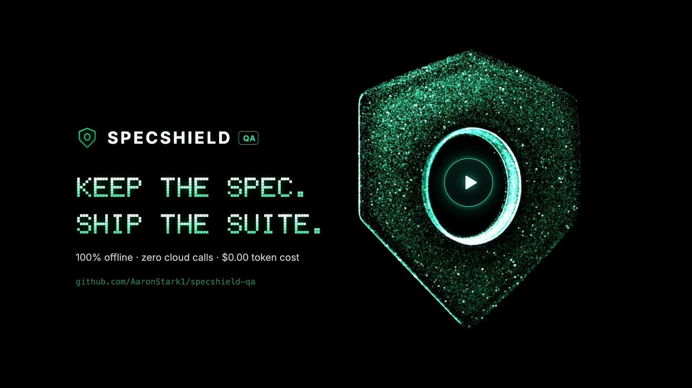

# SpecShield QA — Local-First Spec-to-Test & Playwright E2E Studio

Local-first studio that turns a pasted PRD into **structured requirements**, a **filterable QA test matrix**, and a **downloadable Playwright `.spec.ts` suite (Page Object Model)** — with **zero cloud calls** by default.

Three **Mastra** agents run on **Google Gemma locally through Ollama**, traced with **Sentry Agent Tracing**. No Ollama? The app still runs in a polished **deterministic fallback mode**. No Sentry DSN? Spans become no-ops and nothing leaves the machine.

<p align="center">
  <a href="docs/specshield-showreel.mp4"></a>
</p>

<p align="center">
  <b><a href="docs/specshield-showreel.mp4">▶ Watch the 40-second reel</a></b> (1080p60, with sound) · <a href="docs/specshield-showreel-web.mp4">720p version, 9 MB</a><br>
  <sub>Filmed from the running app: the landing page's particle shield, then a real offline run in the studio, from spec to Playwright suite.</sub>
</p>

## Quick start

```bash
npm install
cp .env.example .env   # optional
npm run dev            # API :8787 + UI :5173
```

Open http://localhost:5173 for the landing page, or go straight to the studio at http://localhost:5173/studio → pick the **Invoice Tracker** sample → **Generate Test Suite**.

| Route | What it is |
| --- | --- |
| `/` | Landing page: a WebGL particle shield (Three.js GPGPU simulation with a cursor-driven fluid) and a plain-language explainer |
| `/studio` | The studio: spec editor with sample loaders on the left, QA Matrix and Playwright Code tabs on the right |
| `/studio?sample=invoice-tracker` | Opens the studio with a sample loaded (`invoice-tracker`, `auth-flow`, `checkout`) |

With Ollama for live Gemma inference:

```bash
OLLAMA_CONTEXT_LENGTH=8192 ollama serve
ollama pull gemma2:9b   # or gemma3:4b for faster runs on resource-constrained laptops
npm run dev
```

Single-port production mode:

```bash
npm run build
npm start              # serves dist/ + API on :8787
```

## How fallback works

`GET /api/health` probes `${OLLAMA_BASE_URL}/models` (1.5 s timeout, 30 s cache) and checks `GEMMA_MODEL` is listed. If unreachable, missing, or `FORCE_FALLBACK=true`, the pipeline uses deterministic generators:

- `parseRequirements()` — headings → features, bold bullets → roles, `FR-XXX-nn` bullets → criteria, numbers-with-units → constraints, keywords → security surfaces.
- `buildMatrix()` — happy-path per feature, boundary at min−1/max+1, negative per required field, security per surface. Deterministic IDs from the title prefix.
- `generatePlaywright()` — template POMs + `test.describe` suites with `// covers` comments.
- `sampleCanned.ts` — hand-polished result for the bundled Freelancer Invoice Tracker sample spec (sha256 match), so the one-click demo is always excellent: 3 roles, 6 features, 30 cases, 6 page objects.

Every artifact carries `mode: "gemma" | "fallback" | "mixed"`. The header chip is honest: green `Gemma 2 9B · Local` or amber `Deterministic Fallback`.

## Environment

| Var | Default | Purpose |
|---|---|---|
| `OLLAMA_BASE_URL` | `http://localhost:11434/v1` | Ollama OpenAI-compatible endpoint |
| `GEMMA_MODEL` | `gemma2:9b` | Model name (`gemma3:4b` faster on lighter laptops, `gemma3:12b` also supported) |
| `GEMMA_TEMPERATURE` | `0.2` | Sampling temperature |
| `GEMMA_MAX_TOKENS` | `undefined` | Optional global override for all steps |
| `GEMMA_MAX_TOKENS_PARSER` | `2048` | Max output tokens for Requirement Parser |
| `GEMMA_MAX_TOKENS_MATRIX` | `3072` | Max output tokens for QA Matrix Architect |
| `GEMMA_MAX_TOKENS_CODEGEN` | `2560` | Max output tokens for Playwright Codegen |
| `OLLAMA_TIMEOUT_MS` | `300000` | Per-call timeout, then per-step fallback |
| `SENTRY_DSN` | `` | Empty = no outbound telemetry; spans stay in-process |
| `SENTRY_ENVIRONMENT` | `local` | Sentry environment |
| `SENTRY_TRACES_SAMPLE_RATE` | `1.0` | Trace sample rate |
| `SENTRY_SEND_DEFAULT_PII` | `true` | Prompt/response previews in AI Agents view |
| `SENTRY_TRACE_URL_TEMPLATE` | `` | Optional deep-link template with `{traceId}`, reported by `/api/health` |
| `PORT` | `8787` | API port |
| `DATA_DIR` | `./data` | `runs.json` location (atomic write temp+rename) |
| `FORCE_FALLBACK` | `false` | Demo fallback even with Ollama running |
| `ROI_*` | see `.env.example` | ROI defaults, editable in UI |

## Architecture

```
Vite :5173 ──/api──▶ Hono :8787 ──▶ Mastra specShieldWorkflow ──▶ Gemma via Ollama :11434/v1
  Landing (/)            │              1 Requirement Parser ─┐       (or deterministic fallback)
  Studio (/studio)       │              2 QA Matrix Architect ─┤
   SpecEditor            │              3 Playwright Codegen ──┘
   Matrix|Playwright     ├── Sentry ai.pipeline ▶ gen_ai.invoke_agent ▶ gen_ai.chat
   History|Value est.    └── JsonStore → ./data/runs.json (no DB)
```

## Front end

- **Landing page** (`src/landing/`). A WebGL particle field sits fixed behind the whole page: 262,144 particles on desktop (65,536 on tablets, 16,384 on phones) held in float textures, pulled onto a signed distance field, and disturbed by a half-float stable-fluids solver that follows the cursor or a touch. It morphs between three shapes, one per stage of the product: the Cyber-Shield, the QA Matrix Lattice and the Playwright Prism checkmark. The hero's HUD switch picks the shape; further down the page the shape follows the section in view and the field dims into a backdrop. With `prefers-reduced-motion`, or without WebGL2 float render targets, a static SVG shield is shown instead.
- **Mini-studio sandbox.** The landing page embeds the real input and output for the bundled Invoice Tracker spec (raw PRD, the 30-case matrix with category filters, the generated `.spec.ts` with copy and zip download). Its data is `src/landing/sandbox/demoSuite.json`, regenerated from the offline engine with `npm run demo:data`.
- **Studio** (`src/pages/Studio.tsx`). A three-step progress strip (Parsing Requirements → Architecting Matrix → Generating Code), the QA Matrix and Playwright Code tabs (Copy Suite, Download .zip), past runs behind History, and one privacy receipt, over a dim colour-graded video backdrop (`public/media/studio-ambient.mp4`, served locally).
- **Privacy receipt.** "0 Outbound Packets" is measured: it counts requests this browser tab makes to any host other than the studio itself. It turns amber and says so when `SENTRY_DSN` is set, because traces (and prompt previews, unless `SENTRY_SEND_DEFAULT_PII=false`) then leave the machine.
- **Fonts.** Inter, Font Awesome 6.5.2 and Geist Pixel Circle are bundled, so the studio makes no third-party requests. The landing page additionally links the BubbledotICG-FinePos display face from `db.onlinewebfonts.com`; offline, its title falls back to Geist Pixel Circle.
- **Showcase clips.** `public/media/*.mp4` are recordings of the real studio. Re-record them with `cd showreel && npm install && npm run showcase` while the app runs with `FORCE_FALLBACK=true SENTRY_DSN=` (see `showreel/record-showcase.mjs`).
- **Showreel.** The reel at the top of this page is filmed from the app itself, not mocked up. `showreel/capture.mjs` drives the landing page and the studio frame by frame under a virtual clock, following the shot list in `showreel/shots.mjs`. Then `npm run render` composes the shots with the transitions, titles and the generated score, and encodes `docs/specshield-showreel.mp4` and its 720p web cut. Run the capture against a private stack whose `DATA_DIR` is a new, empty folder, because the studio reopens the latest run on load. The exact commands are at the top of `capture.mjs`.

## Scripts

- `npm run dev` — API + web with `concurrently`
- `npm run typecheck` — both tsconfigs
- `npm run lint` — eslint (warnings ok)
- `npm run build` — typecheck + vite build
- `npm run smoke` — fallback end-to-end (≥18 cases, 4 categories, real Playwright code)
- `npm run demo:data` — regenerate the landing page's sandbox data from the offline engine
- `npx tsx scripts/sample-run.ts` — live SSE probe printing per-step duration and tokens

## Screenshots and reel

- `docs/specshield-showreel.mp4` — the 40-second reel, 1080p60 with sound
- `docs/specshield-showreel-web.mp4` — the same reel at 720p30, under GitHub's 10 MB upload limit for READMEs, issues and PRs
- `docs/specshield-showreel-thumb.jpg` — the reel's end-card frame with a play button, used as the thumbnail above
- `docs/landing-hero.png` — landing page hero
- `docs/landing-workflow.png` — landing page workflow section with the lattice backdrop and circuit rail
- `docs/studio-revamp.png` — the current studio after a sample run
- `docs/studio-overview.png` — the original studio (cover image of the DEV post; keep the file name)
- `docs/sentry-waterfall.png` — Sentry trace waterfall
- `docs/sentry-span-attributes.png` — span attributes with `gen_ai.usage.*`

## License

MIT © 2026 SpecShield QA contributors
